  

## About

Koha MARC Helper helps library staff catalogue faster in Koha: search for book records, draft MARC 21 entries with AI help, and keep settings private in your own browser.

## Highlights

- Search book records and draft MARC 21 records for Koha
- Optional AI help for drafting entries
- Settings, API keys and draft records stay in your browser
- No user accounts, no analytics, no advertising and no tracking
- Book searches and AI requests go directly from your browser to the services you choose

## Built with

`Koha ILS` · `MARC 21` · `Chrome Extension` · `Firefox Add-on`

## Maintainer

Built and maintained by **[Dr. Amalendu Das](https://github.com/amalendu-ls)**, Librarian, Nabadwip Vidyasagar College.
[Portfolio](https://sites.google.com/nvc.ac.in/amalendudas/home_1) · [ORCID](https://orcid.org/0000-0003-0799-0599)
